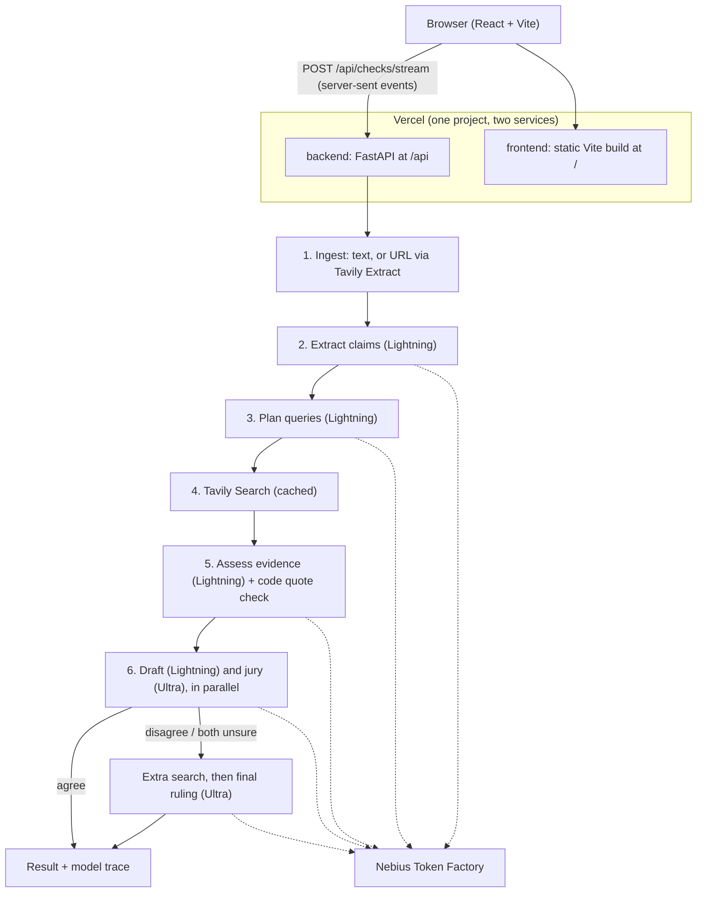

# Verity

**An evidence investigation desk: Verity checks text or an article claim by claim, with quotes
that are verified against their sources and a jury of two NVIDIA Nemotron models.**

- **Live demo:** https://verity-six-kappa.vercel.app
- **Video:** _link coming_
- Built for the Nebius x NVIDIA Global AI Hackathon (track: Best Apps and Agents).

## What it does

- **Claim by claim.** Paste text (up to 5,000 characters) or an article URL. Verity finds up to
  three checkable claims and gives each one its own verdict: `TRUE`, `FALSE`, `MISLEADING` or
  `UNVERIFIED`, with a confidence and an explanation.
- **Verified quotes.** The model must quote its sources word for word, and code checks that each
  quote really appears in the page. Quotes that don't are thrown away, so made-up quotes never
  reach the screen.
- **Two-model jury.** Nemotron 3.5 Lightning drafts a verdict while Nemotron 3 Ultra judges the
  same evidence independently. If they disagree, or both find the evidence too weak, Verity searches
  again with the queries they ask for and Ultra makes the final ruling. Every result shows whether
  the jury agreed.
- **Fully auditable.** The model trace lists every AI call: which Nemotron model, which step,
  tokens, time and cost. A typical check takes 10–30 seconds and costs under half a cent per claim.
- **Measured, not claimed.** A benchmark page compares a single model with the jury on a labeled
  test set.

## How we use NVIDIA Nemotron on Nebius Token Factory

All AI inference runs on **Nebius Token Factory** (OpenAI-compatible API) with **NVIDIA Nemotron**
models only. No other model or AI API runs in the app. Model IDs come from environment variables,
and the app refuses to start if either one is not an NVIDIA model or if both are the same model
(the jury must be independent).

| Pipeline step | Model | Why this model |
|---|---|---|
| Extract checkable claims | `nvidia/Nemotron-3_5-Lightning` | Fast and cheap; reasoning on for this short step, which stopped it from inventing claims |
| Plan search queries (neutral, supporting, refuting) | `nvidia/Nemotron-3_5-Lightning` | Fast, short structured output |
| Assess evidence and pick exact quotes | `nvidia/Nemotron-3_5-Lightning` | Reads up to 8 sources per claim in one call; reasoning off to keep it at 2–3 s |
| Draft verdict | `nvidia/Nemotron-3_5-Lightning` | First opinion |
| Independent jury verdict | `nvidia/Nemotron-3-Ultra-550b-a55b` | A larger, different model judging the same evidence on its own |
| Final ruling after a disagreement | `nvidia/Nemotron-3-Ultra-550b-a55b` | The stronger model settles disputes, with the extra evidence |

Nemotron models on Token Factory offer function calling but no JSON mode, so every structured step
forces a tool call with a JSON schema. If the output is invalid, Verity sends the error back to the
model once (as a tool result) so it can correct itself. The mode is a setting per model: forced
tool call, optional tool call, or JSON parsed from text.
`docs/model_probe.md` records the probe that chose these models and modes.

## How we use Tavily

- **Search** with `basic` depth, 3 queries per claim, results cached for 24 hours.
- **Full page text** (`include_raw_content`) so the model sees the passages most relevant to the
  claim, not only a short snippet. Quotes are verified against this text.
- **Domain diversity:** at most 2 sources per site and 8 per claim, ranked with a small, fixed list
  of reliable domains.
- **Extract** for article URLs, and **favicons** for the source list.
- Tavily's AI answer (`include_answer`) is never used: all reasoning is done by Nemotron.

## Architecture



- The web app is hosted on **Vercel** (Services: the FastAPI backend at `/api`, the Vite frontend at
  `/`). All AI calls go to Nebius Token Factory.
- Each check runs inside its request and streams live progress to the browser, ending with the
  full result. This suits serverless hosting, where work left running after a response may be paused.
- Web content is treated as untrusted data: it is tagged in prompts, the models are told never to
  follow instructions inside sources, and every quote shown is checked by code.
- Protection: 5 checks per visitor per 10 minutes, 150 checks per day overall, at most 3 claims and
  2 extra queries per check, and a 240-second time limit.

## Benchmark

`eval/claims_draft.jsonl` holds 40 claims (20 `TRUE`, 20 `FALSE`), each with an evidence link.
`scripts/run_eval.py` checks every claim through the full pipeline and compares a single model (the
Lightning draft) with the two-model jury. The results appear on the site's Benchmark page.

_Results: to be added once a team member has confirmed every label (see `eval/VERIFY_CLAIMS.md`)._

Limits of this method: 40 claims is a small set, the claims are short factual statements (no
`MISLEADING` cases), and web search results change over time.

## Run locally

Prerequisites: Python 3.12, Node.js 22+, a Nebius Token Factory API key and a Tavily API key.

```bash
cp .env.example .env    # then put NEBIUS_API_KEY and TAVILY_API_KEY in .env
make install            # Python venv + backend deps + frontend deps
make dev                # backend on :8000, frontend on http://localhost:5173
make test               # pytest + ruff + TypeScript + Vitest
```

To run it the way Vercel does: `npm i -g vercel`, then `vercel dev --local` from the repo root
(http://localhost:3000).

One real end-to-end check: `.venv/bin/python scripts/smoke_test.py --url http://localhost:8000`.

## Deploy

**Vercel (the live demo).** Import the GitHub repo as a new project, keep the **Services** preset
and root `./` (`vercel.json` defines both services), and add these environment variables:

| Name | Value |
|---|---|
| `NEBIUS_API_KEY` | your Nebius Token Factory API key |
| `TAVILY_API_KEY` | your Tavily API key |
| `MODEL_FAST` | `nvidia/Nemotron-3_5-Lightning` |
| `MODEL_JUDGE` | `nvidia/Nemotron-3-Ultra-550b-a55b` |

Every other setting has a default (see `.env.example`). After deploying, `/api/health` should list
both models.

**Docker (any container host).** `docker build -t verity .` builds one image with the frontend and
backend. It listens on `$PORT` (default 8000) and needs the same 4 variables. `deploy/` also has
scripts for a Nebius AI Cloud Serverless Endpoint, which the live demo does not use.

## Limitations

- Verity depends on what web search finds, and it can be wrong. Treat a verdict as a starting point
  for your own reading, not a final answer.
- Not for medical, legal or financial decisions.
- English is the best tested language.
- Past checks are stored per server instance, so share links can stop working after a redeploy or
  when the host shuts an idle instance down.

## License and team

MIT (see `LICENSE`). Built by the Verity team.
